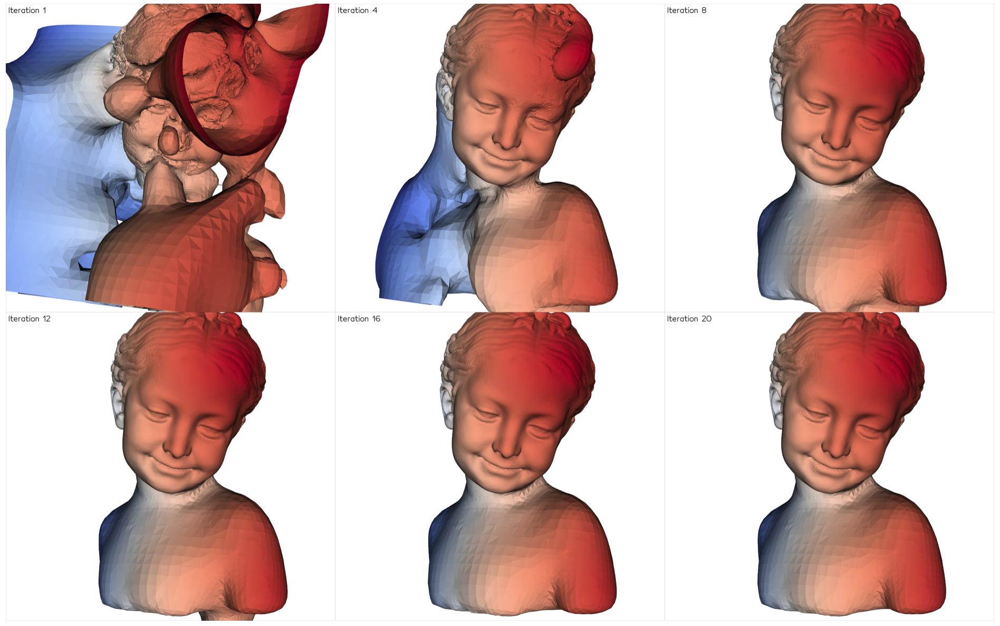

# Iterative Poisson Surface Reconstruction

This program is a python re-implementation of iterative Poisson Surface Reconstruction(iPSR) on unoriented point clouds. It iteratively estimates point normals and reconstructs the surface using the Poisson reconstruction algorithm. The program can visualize the reconstruction process and save intermediate results.

Two extensions also implemented in this program:
- Weighted normal updating which updates the normals at each iteration as
$$n_i = \sum_{j \in m} \frac{a_jn_j}{dist(p_i, f_j)}$$ for associated
faces $$f_j$$ and normals $$n_j$$, and distance dist($$p_i$$, $$f_j$$) from point $$p_i$$ to face
$$f_j$$

- Annealing for neighbor count (K) which reduces the number of neighbors
throughout.

## Features
- Iterative normal estimation
- Multiple initialization methods for normals
- Weighted normal updating
- Annealing for neighbor count
- Interactive visualization of reconstruction steps
- Support for saving intermediate results

## Requirements
- Python 3.10 or later (3.13 tested)
- NumPy
- SciPy
- Open3D 0.20 or later (exposes the Poisson screening weight)
- Vedo
- tqdm

## Installation
From the root of the repository, install the package and its dependencies with pip:
```bash
pip install .
```
(use `pip install -e .` for an editable install while developing).

## Usage
Installing the package provides the `repsr` command:
```bash
repsr input_pointcloud.ply [options]
```
or, equivalently,
```bash
python -m repsr input_pointcloud.ply [options]
```

### Options
- `--init`: Method to estimate initial normals (`random`, `estimate`, `heuristic`)
- `-i, --max-iter`: Maximum number of iterations (default: 30)
- `--depth`: Depth of the Poisson octree (default: 10)
- `-pw, --point-weight`: Screening weight of the Poisson reconstruction (default: 10, as the original iPSR)
- `--solver`: Poisson solver, `open3d` (official C++ PoissonRecon, default), `python` (pure NumPy / SciPy re-implementation in `repsr/psr.py`; as the official one, it stops refining where the samples are sparse, but its time and memory grow ~4x per depth actually reached: depth 9 is practical), or `fused` (the iPSR loop fused into the NumPy solver, coarse to fine; see below)
- `--start-depth`: `fused` only, depth of the first stage (default: two depths above the finest one)
- `--coarse-iters`: `fused` only, maximum number of iterations of the stages before the finest one (default: 5)
- `-k, --k-neighbors`: Number of neighbors to consider (default: 10)
- `--threshold`: Convergence threshold (default: 1e-4 on the mean normal change; `fused`: 0.175 on the mean of the 0.1% largest changes, as iPSR)
- `-p, --plot`: Number of iterations to plot (default: 0)
- `-o, --output`: Output directory (default: "out/")
- `-s, --save-iters`: Save intermediate iteration meshes and normals
- `-w, --weighted`: Use weighted normal updating
- `-a, --anealing`: Use annealing for number of neighbors

### Example
To reconstruct a point cloud with visualization and intermediate results:
```bash
repsr bunny.ply -i 20 -k 15 --init heuristic -p 5 -o results/ -s -w
```

### Pure Python Poisson reconstruction
`repsr/psr.py` re-implements screened Poisson surface reconstruction with
NumPy and SciPy only, following the discretisation of the official code
(adaptive octree with density-dependent depth, quadratic B-spline normal field,
hierarchical trilinear basis with depth-weighted screening, cascadic conjugate
gradient solve, SciPy KD-tree for the sample density, marching tetrahedra), to
be checked against the official implementation:
```python
from repsr import poisson_reconstruction
vertices, triangles, densities = poisson_reconstruction(points, normals, depth=8, point_weight=10)
```

### Fused iPSR (`--solver fused`, new in 0.2.0)
The original iPSR runs screened PSR as a black box: every iteration rebuilds
the octree, the density estimate and the linear systems, although only the
normals change. `repsr/fused.py` runs the iPSR loop inside the NumPy solver:
- everything that depends only on the point positions (samples, density,
  octree, stiffness and screening matrices, interpolation between depths,
  KD-trees) is built once; an iteration rebuilds only the normal field (the
  right-hand side), re-solves with conjugate gradients started from the
  previous solution, extracts the surface and updates the normals;
- the iterations go coarse to fine: they start a few depths above the
  finest one on the samples gathered per cell of that depth, and every
  finer stage inherits the normals of the coarser one;
- as in iPSR, the indicator function vanishes on the domain boundary
  (Dirichlet), which fixes the global sign of the normals (with the Neumann
  boundary of Open3D the result may come out inside out);
- the normal update and stopping rule are those of iPSR (k nearest samples
  of every face, area-weighted; average of the 0.1% largest normal changes
  below 0.175).

```python
import open3d as o3d, repsr
meshes, normals = repsr.fused_iterative_reconstruction(o3d.io.read_point_cloud("bunny.ply"))
```

## Output
The program generates in the output directory:
- Final reconstructed mesh (`mesh.ply`)
- Final estimated normals (`normals.ply`)

## Acknowledgment
This program is developed Based on Iterative Poisson Surface Reconstruction by Fei Hou, Chiyu Wang, Wencheng Wang, Hong Qin, Chen Qian, Ying He in 2022 (https://lcs.ios.ac.cn/~houf/pages/ipsr/index.html).

This code relies on the original implementation of Poisson surface
reconstruction by Michael Kazhdan and et al. (http://www.cs.jhu.edu/~misha/Code/PoissonRecon/Version8.0/) through Open3D.
